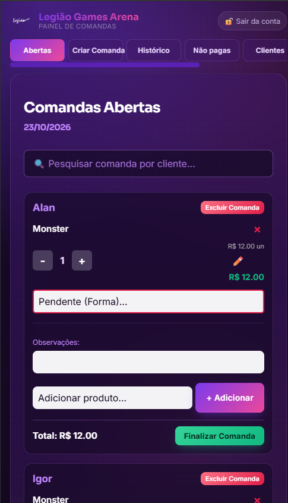
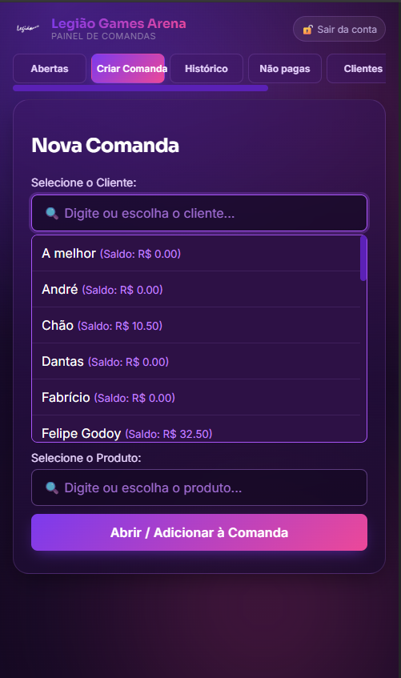
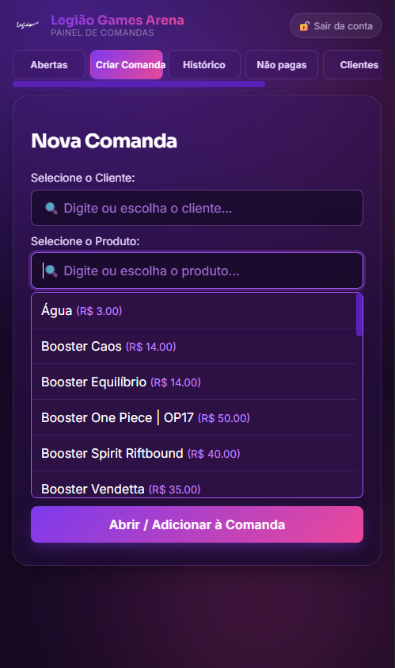
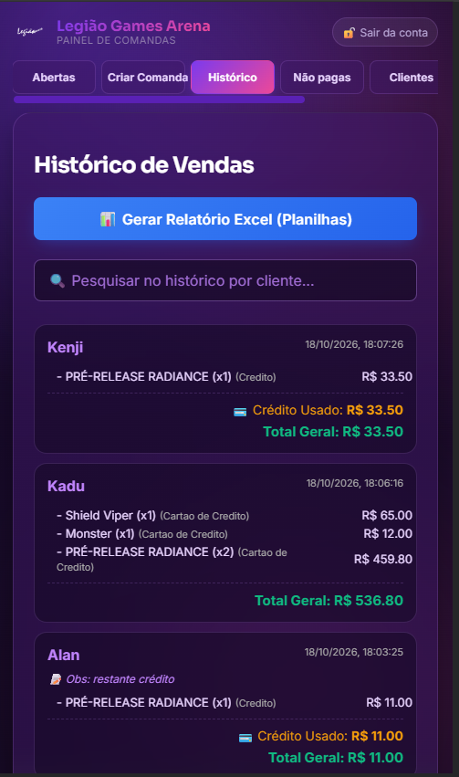
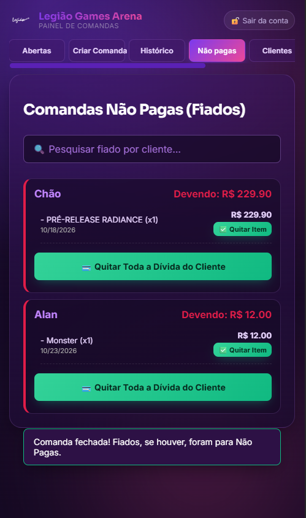
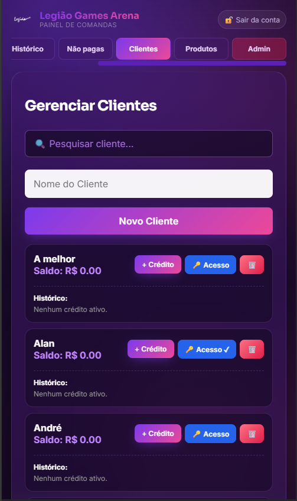
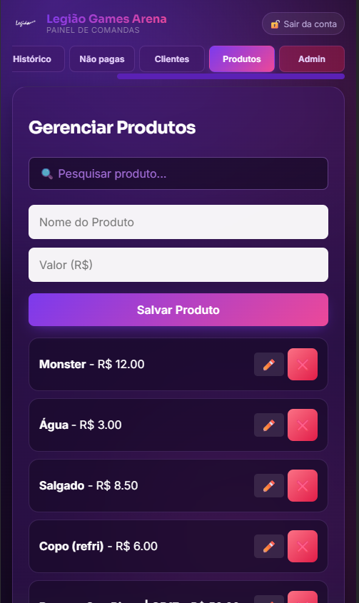
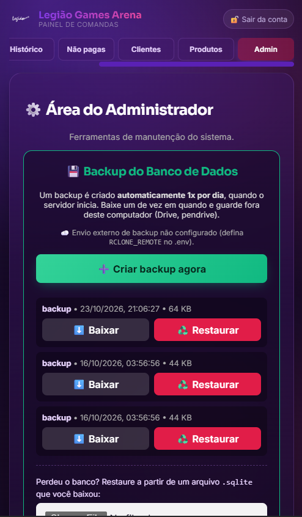
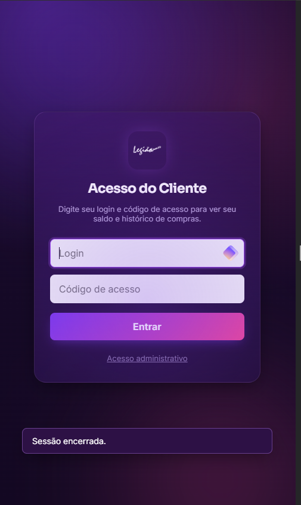
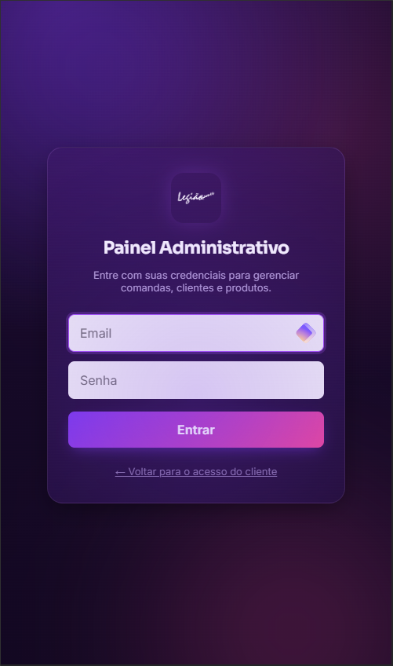

# Sistema de Comandas — Legião Games

Sistema interno de comandas da Legião Games: clientes com crédito, produtos e
serviços, controle de fiados, backups automáticos e relatórios em Excel.

## Telas

<table>
  <tr>
    <td width="50%">
      
      <p align="center"><strong>Comandas abertas</strong></p>
    </td>
    <td width="50%">
      
      <p align="center"><strong>Nova comanda</strong></p>
    </td>
  </tr>
  <tr>
    <td width="50%">
      
      <p align="center"><strong>Produtos à venda</strong></p>
    </td>
    <td width="50%">
      
      <p align="center"><strong>Histórico de vendas</strong></p>
    </td>
  </tr>
  <tr>
    <td width="50%">
      
      <p align="center"><strong>Não pagas (fiados)</strong></p>
    </td>
    <td width="50%">
      
      <p align="center"><strong>Gerenciar clientes</strong></p>
    </td>
  </tr>
  <tr>
    <td width="50%">
      
      <p align="center"><strong>Gerenciar produtos</strong></p>
    </td>
    <td width="50%">
      
      <p align="center"><strong>Área do administrador</strong></p>
    </td>
  </tr>
  <tr>
    <td width="50%">
      
      <p align="center"><strong>Acesso do cliente</strong></p>
    </td>
    <td width="50%">
      
      <p align="center"><strong>Painel administrativo</strong></p>
    </td>
  </tr>
</table>

## Como funciona

```
Navegador ──▶ Express (server.js) ──▶ SQLite (legiao.sqlite)
                 │
                 └── comandas abertas também vão para
                     comandas_abertas.json, incluída nos backups
```

A interface fica em `public/` e é servida pelo próprio servidor. Não há build
nem framework de front-end — HTML/CSS/JS direto.

## Estrutura

```
public/               interface (HTML/CSS/JS)
Screenshots/          telas do sistema usadas neste README
server.js             servidor e API
relatorio.js          relatório .xlsx gerado pelo Node (exceljs)
backup.js             backup/restauração do banco
popular_banco.py      dados de exemplo (só para teste)
gerar_relatorio.py    relatório .xlsx com gráficos (uso local opcional)
.env / .env.example   configuração (não versionar)
backups/              arquivos de backup (30 dias de retenção)
```

## Configuração

Copie `.env.example` para `.env` e preencha. O servidor não inicia sem
`ADMIN_USER`, `ADMIN_PASS` e `ENCRYPTION_KEY`.

Para gerar a chave de criptografia:

```bash
node -e "console.log(require('crypto').randomBytes(32).toString('hex'))"
```

Trocar a chave depois de cadastrar acessos de clientes torna os logins salvos
ilegíveis; nesse caso é preciso recadastrar cada cliente no painel.

## Executando

```bash
npm install
npm start
```

O banco é criado vazio na primeira execução. Acesse `http://localhost:3000`
no navegador (a porta aparece no terminal).

## Relatório em Excel

```bash
pip install openpyxl
python gerar_relatorio.py
```

(opcional, só para uso local com gráficos — o painel baixa o mesmo
relatório gerado pelo próprio servidor)

| Aba | Conteúdo |
|-----|----------|
| Histórico Geral | Todas as vendas, mais recentes primeiro |
| Lucro Diário | Total vendido por dia |
| Itens Consumidos | Produtos do mais para o menos vendido |
| Clientes com Crédito | Saldo ainda válido por cliente |
| Não Pagos (Fiados) | Itens pendentes |

O relatório é gerado pelo próprio servidor (Node + exceljs) — não exige
Python nem gráfico embutido; os números são baixados pelo painel
administrativo. O script `gerar_relatorio.py` continua existindo para uso
local (com gráficos), mas o servidor não depende mais dele.

O script `popular_banco.py` preenche o banco com dados falsos para teste e
**apaga tudo** que já existir antes.

## Backups

O sistema gera backup diário automaticamente (no primeiro acesso do dia) e um
extra a cada 25 comandas finalizadas. Cada arquivo contém o banco completo,
incluindo as comandas abertas. Backups com mais de 30 dias são apagados,
preservando sempre o mais recente.

Download e restauração ficam na aba **Admin** do painel administrativo (tela
"Área do administrador" acima). Para enviar os backups
para a nuvem, configure `RCLONE_REMOTE` no `.env` (requer
[rclone](https://rclone.org)).

## Banco de dados

| Tabela | Conteúdo |
|--------|----------|
| `products` | `id`, `name`, `price` |
| `clients` | `id`, `name`, `credits` (JSON `[{ amount, expiresAt }]`) |
| `client_logins` | credenciais de acesso do cliente (login com HMAC-SHA256, código em AES-256-GCM) |
| `comandas` | `clientId`, `items` (JSON), `totalGeral`, `observacao`, `data` |
| `fiados` | itens pendentes de pagamento |
| `sessions` | sessões (sobrevivem ao reinício do servidor) |

Cada item de uma comanda guarda o preço do momento da venda:

```json
{ "productId": 1, "name": "Hora PC Gamer", "price": 15.0, "quantity": 2, "paymentMethod": "PIX" }
```

## Segurança

- Sessões com token de 256 bits; **só o SHA-256 do token fica no banco** (roubo
  do arquivo do banco não entrega sessões prontas); expiração deslizante de 30
  dias com teto absoluto de 90 dias
- Sessões de cliente são revogadas na hora quando o admin muda/reset/remove o
  acesso dele, e também quando o cliente é excluído
- Rate limiting geral na API + bloqueio de logins: 5 erros em 15 minutos
  bloqueiam o IP por 15 minutos (o `TRUST_PROXY` configurado errado — ou não
  configurado — torna isso burlável via header forjado; revise o `.env`)
- CSP rigorosa: `script-src 'self'` — nenhum script inline, e TODO texto vindo
  do servidor é escapado antes de entrar no HTML no front (`escHtml`)
- Finalizar comanda roda dentro de uma transação: ou grava comanda + desconto
  de crédito + fiados, ou nada; crédito insuficiente é recusado no servidor
- Restaurações: uma por vez, magic bytes SQLite conferidos antes de gravar,
  limite de 100 MB e cópia de segurança automática do estado atual
- Backup/restauração de admin são as únicas ferramentas expostas; só rota com
  login de admin as alcança
- Credenciais de administrador e chave de criptografia lidas obrigatoriamente
  do ambiente; não existe valor padrão, e senha de admin com menos de 10
  caracteres faz o servidor recusar a iniciar
- Valores e tamanhos de entrada têm limites (preço ≤ R$ 1.000.000, nome ≤ 120,
  observação ≤ 500, comanda ≤ 200 itens etc.); todos os campos de pagamento
  são conferidos contra uma lista fixa; consultas SQL usam placeholders
- Headers de segurança completos via helmet (CSP, HSTS, no-sniff,
  frame-ancestors 'none', Referrer-Policy...) e `Cache-Control: no-store` nas
  rotas da API
- `npm audit` sem vulnerabilidades (exceljs com `uuid` fixado via overrides)

## Publicação na internet

Os arquivos de implantação (VPS, HTTPS com Caddy, PM2, rclone) estão na pasta
`deploy/`. O guia completo está em `deploy/DEPLOY.md`.

## Licença

Uso restrito à Legião Games.
